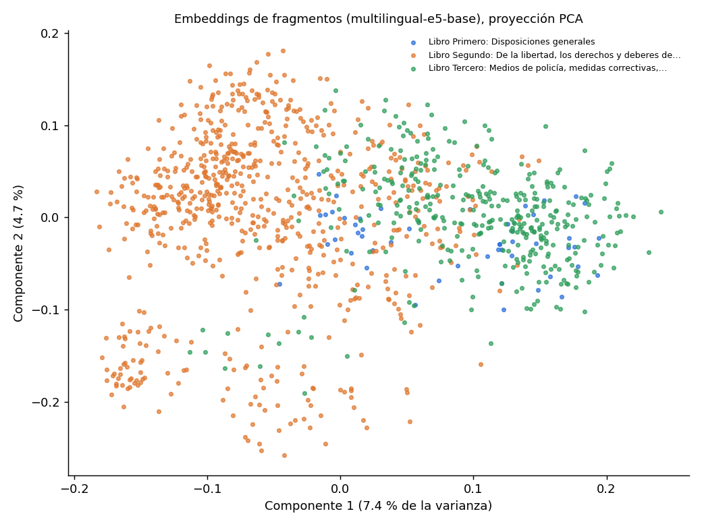

# Fase 3: representación vectorial e indexación

**Corpus:** Ley 1801 de 2016, 1125 fragmentos de 249 artículos (consulta 2026-11-06).  
**Banco de preguntas:** 40 preguntas con artículos esperados (las 10 del enunciado y 30 más) y 5 fuera de dominio, en `recursos/preguntas_evaluacion.json`.  
**Generado:** 2026-11-12 con `indexacion.py` 1.0.0 (FAISS 1.13.0, sentence-transformers 5.1.2).

## 1. Modelo de embeddings

Se compararon dos modelos multilingües de sentence-transformers que corren en local (sin claves de API, sin costo por consulta y sin enviar el texto a terceros):

- **`intfloat/multilingual-e5-base`**: 768 dimensiones, máximo 512 tokens por texto.
- **`sentence-transformers/paraphrase-multilingual-MiniLM-L12-v2`**: 384 dimensiones, máximo 128 tokens por texto.

`multilingual-e5-base` (Wang et al., 2024) se entrenó específicamente para recuperación con pares pregunta–pasaje (prefijos «query:» y «passage:»), admite textos de hasta 512 tokens y está entre los mejores modelos abiertos de su tamaño en las tareas de recuperación del benchmark MTEB. `paraphrase-multilingual-MiniLM-L12-v2` es más liviano y rápido, pero se entrenó para parafraseo (frases de longitud similar) y corta los textos en 128 tokens. Una alternativa de pago es el modelo de embeddings de la API de OpenAI; el diseño permite cambiarlo con el parámetro `--modelos`.

## 2. Estrategias de segmentación comparadas

| Estrategia | Unidad que se vectoriza | Vectores |
|---|---|---|
| `fragmento` | fragmento jerárquico de `corpus.json` (encabezado, numeral o parágrafo) precedido de «artículo N. Epígrafe.» | 1125 |
| `articulo` | artículo completo: epígrafe y todos sus fragmentos | 249 |
| `fijo` | ventana fija de 200 palabras con 50 de solape sobre el texto corrido, sin respetar artículos | 340 |

## 3. Resultados de recuperación

P@k: proporción de las k unidades recuperadas que contienen un artículo esperado. R@k: proporción de los artículos esperados que aparecen en las k primeras unidades. MRR: media del inverso de la posición de la primera unidad relevante. «Palabras top-5»: tamaño del contexto que recibiría el LLM con k = 5.

| Modelo | Estrategia | P@1 | P@5 | R@1 | R@5 | R@10 | MRR | Palabras top-5 | Textos truncados | ms/consulta |
|---|---|---|---|---|---|---|---|---|---|---|
| multilingual-e5-base | `fragmento` **(elegido)** | 0.875 | 0.625 | 0.703 | 0.884 | 0.916 | 0.924 | 240 | 2 de 1125 | 5 |
| multilingual-e5-base | `articulo` | 0.700 | 0.250 | 0.548 | 0.856 | 0.942 | 0.785 | 1183 | 40 de 249 | 5 |
| multilingual-e5-base | `fijo` | 0.800 | 0.475 | 0.681 | 0.917 | 0.977 | 0.876 | 995 | 0 de 340 | 5 |
| paraphrase-multilingual-MiniLM-L12-v2 | `fragmento` | 0.775 | 0.450 | 0.579 | 0.800 | 0.881 | 0.858 | 264 | 144 de 1125 | 2 |
| paraphrase-multilingual-MiniLM-L12-v2 | `articulo` | 0.575 | 0.210 | 0.425 | 0.712 | 0.864 | 0.696 | 1174 | 158 de 249 | 2 |
| paraphrase-multilingual-MiniLM-L12-v2 | `fijo` | 0.350 | 0.240 | 0.270 | 0.653 | 0.811 | 0.521 | 997 | 339 de 340 | 2 |

**Expansión de consultas con el diccionario de sinónimos de la fase 2** (configuración elegida): MRR 0.924 → 0.950, R@5 0.884 → 0.884.

## 4. Análisis

- Con el modelo elegido el orden por MRR es `fragmento` (0.924) > `fijo` (0.876) > `articulo` (0.785).
- El artículo completo da un contexto de 1183 palabras con k = 5, frente a 240 con fragmentos: más contexto por consulta (más tokens y costo en el LLM) y artículos largos que el modelo trunca (40 de 249 superan 512 tokens).
- Las ventanas fijas cortan artículos por la mitad y mezclan el final de uno con el comienzo del siguiente: no se pueden citar con precisión (RF2) ni filtrar por vigencia, porque una ventana no corresponde a un artículo, parágrafo o numeral. MRR: 0.876.
- Las ventanas fijas logran el mayor R@5 (0.917), pero en parte porque cada ventana abarca dos o tres artículos: cubren más artículos esperados a costa de un contexto 4 veces más largo que el de los fragmentos.
- Con la misma estrategia, `paraphrase-multilingual-MiniLM-L12-v2` obtiene MRR 0.858 y R@5 0.800, frente a 0.924 y 0.884 del modelo elegido.
- Se elige `fragmento` con `multilingual-e5-base`. Es la configuración citable con mayor MRR (0.924) y R@5 (0.884). Además devuelve exactamente el parágrafo o numeral que responde, con su estado de vigencia y sus notas, lo que permite citar con precisión (RF2) y mostrar la fuente (RF5).

## 5. Umbral para preguntas fuera del Código (RF3)

Con la configuración elegida, la similitud coseno del mejor resultado es en promedio 0.873 para preguntas del Código (mínimo 0.809) y 0.815 para preguntas fuera de dominio (máximo 0.821). Las distribuciones se solapan, así que la similitud sola no basta para rechazar preguntas: el prompt del LLM debe instruirlo a responder que la información no está en el Código cuando el contexto no la contiene.

## 6. Preguntas con peor recuperación (configuración elegida)

| # | Pregunta | Esperados | Artículos en top-5 | RR |
|---|---|---|---|---|
| 35 | ¿Qué pasa si le falto al respeto a un policía o no obedezco sus órdenes? | 35 | 171, 227, 150, 35 | 0.20 |
| 4 | ¿Qué puedo hacer si no estoy de acuerdo con una orden de comparendo? | 223A, 222, 180 | 219, 218, 223A | 0.25 |
| 9 | ¿Cuáles son las autoridades de policía y qué competencias tienen? | 198, 205, 206, 209, 210 | 11, 198, 16 | 0.50 |
| 13 | ¿Qué pasa si me cuelo en el TransMilenio sin pagar el pasaje? | 146 | 183, 146 | 0.50 |
| 33 | Si me atraso en el pago de una multa, ¿me cobran intereses? | 182 | 183, 182, 223A | 0.50 |
| 8 | ¿Qué dice el Código sobre la tenencia de animales domésticos o potencialmente peligrosos? | 117, 124, 126, 127, 134 | 134, 124 | 1.00 |

## 7. Índice FAISS construido

- Modelo: `intfloat/multilingual-e5-base`; estrategia: `fragmento`; 1125 vectores de 768 dimensiones.
- Tipo: `IndexFlatIP` (búsqueda exacta por producto interno sobre vectores normalizados, equivalente a la similitud coseno). Con unos miles de vectores la búsqueda exacta tarda milisegundos; un índice aproximado (IVF, HNSW) solo compensaría con cientos de miles.
- Archivos: `resultados/indice/fragmento/indice.faiss`, `embeddings.npy`, `unidades.json` (texto y metadatos de cada vector, en el mismo orden) y `config.json`. Las otras estrategias quedan en sus carpetas para repetir la comparación.

Proyección de los embeddings en sus dos componentes principales, coloreada por libro del Código.
